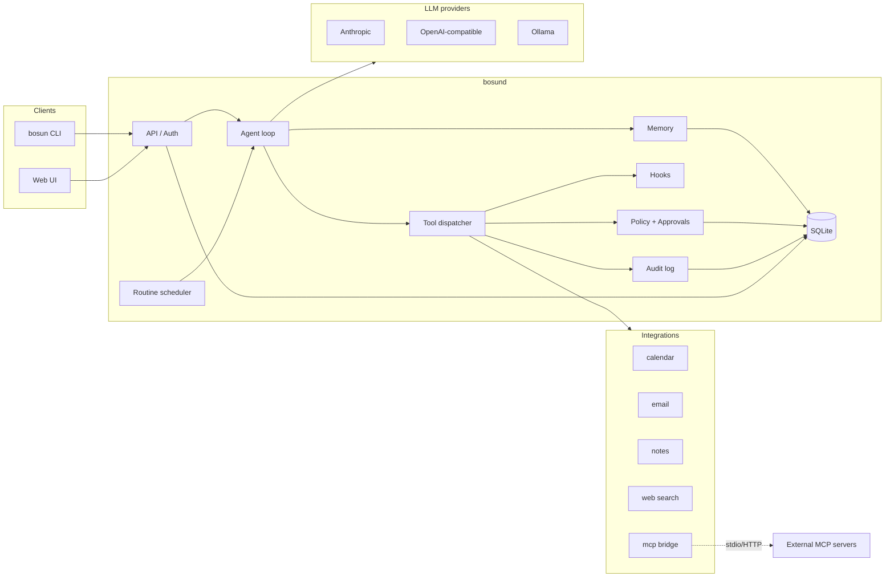

# Bosun — Architecture

Companion to [GOALS.md](GOALS.md). This describes how Bosun is built; GOALS.md
describes why.

## Decisions this architecture is built on

| Decision | Choice | Consequence |
|---|---|---|
| Language | **Go** | Single static binary, easy service install, embedded web UI |
| Integration isolation | **In-process plugins** | Integrations are Go packages compiled into the binary; permissions are enforced at the dispatcher, not a process boundary |
| Third-party extensibility | **MCP bridge** | External MCP servers attach as ordinary integrations without a rebuild |
| Runtime | **Daemon + thin clients** | `bosund` owns agent, memory, schedules; `bosun` CLI and web UI talk to it over HTTP |
| Proactivity | **Opt-in routines** | Scheduled/event-driven agent runs, same permission model as interactive use |
| Audience | **Household / small team** | Users, roles, sessions, per-user memory, permissions and credentials |

## System overview



Two binaries: **`bosund`** (the daemon, does all the work) and **`bosun`** (the
CLI, a thin client). The web UI is static assets embedded in `bosund` with
`embed.FS`.

## Repository layout

```
cmd/
  bosund/            daemon entrypoint
  bosun/             CLI entrypoint
internal/
  agent/             agent loop, session state, context assembly
  llm/               Provider interface + implementations
    anthropic/
    openai/          any OpenAI-compatible endpoint
    ollama/
    providers/       builds the registry from bosun.yaml; per-request API key lookup
  integration/       Integration/Tool interfaces, registry
  dispatch/          the dispatcher: the single path from the model to a tool
  integrations/      first-party integrations (one package each)
    calendar/
    email/
    notes/
    websearch/
    mcp/             bridge: external MCP servers -> Integration
  policy/            capability rules, risk defaults, decision engine
  approval/          pending approvals, delivery to clients, timeouts
  channels/          chat-app frontends (Linker, Manager); telegram/ bot
  hooks/             hook registry and runner
  routines/          cron + event triggers, routine runner
  memory/            per-user memory store and retrieval
  auth/              users, roles, sessions
  vault/             credential vault, master key sources (file, OS keychain)
  providers/         email provider presets (hosts, app passwords, CalDAV/ICS), autodiscovery
  tlsutil/           self-signed cert generation, fingerprints, pinned clients
  api/               HTTP + SSE handlers, request auth
  config/            bosun.yaml loading, validation, defaults
  envfile/           $data_dir/env loading (0600 KEY=VALUE file)
  doctor/            health checks behind `bosun doctor` and GET /v1/doctor
  store/             SQLite schema, migrations, queries
  audit/             append-only action log
  webui/             web UI (plain HTML/JS, embedded into bosund)
  oauth/             OAuth2 account linking (bosun connect google|microsoft)
docs/
```

Everything under `internal/` is private to the module. If a stable public API
for out-of-tree integrations is wanted later, the `integration` package is the
one to promote to `pkg/`.

## Core interfaces

These are the contracts every pluggable part conforms to. They are intentionally
small.

### LLM provider

```go
package llm

type Provider interface {
    Name() string
    Complete(ctx context.Context, req Request) (Response, error)
    Stream(ctx context.Context, req Request) (<-chan Event, error)
}

type Request struct {
    Model    string
    System   string
    Messages []Message
    Tools    []ToolSpec   // provider-neutral tool definitions
    MaxTokens int
}
```

Providers translate between Bosun's neutral message/tool format and their own
API. Model selection is config: `llm.default` plus optional per-routine and
per-user overrides. Adding a provider is one package implementing `Provider`
plus a line in the registry.

### Integration and tool

```go
package integration

type Integration interface {
    Manifest() Manifest
    Init(ctx context.Context, cfg Config, creds CredentialSource) error
    Tools() []Tool
    Close() error
}

type Manifest struct {
    Name         string       // "email"
    Version      string
    Capabilities []Capability // every capability any tool may use
    ConfigSchema json.RawMessage
    CredentialKinds []string  // "oauth2:google", "apikey", ...
}

type Tool struct {
    Name        string          // "email.send"
    Description string
    Capability  Capability      // "email.send"
    Risk        Risk            // Read | Write | Destructive
    InputSchema json.RawMessage
    Handler     func(ctx context.Context, in json.RawMessage) (Result, error)

    // optional
    ScopeArg string // argument whose (normalized) value scopes policy, e.g. "site"
    RiskFunc func(ctx context.Context, args json.RawMessage) Risk // may escalate, never lower
}

type Result struct {
    Content     string          // text handed to the model
    Untrusted   bool            // true for anything originating outside Bosun
    Data        any             // structured result for the UI / hooks
    AuditDetail json.RawMessage // stored as the audit entry's Detail
}

// optional, implemented by an Integration; called only when policy asks
type Previewer interface {
    Preview(ctx context.Context, tool string, args json.RawMessage) ([]byte, string, error)
}
type ApprovalDetailer interface {
    ApprovalDetails(ctx context.Context, tool string, args json.RawMessage) (json.RawMessage, error)
}
```

Rules that keep in-process plugins honest:

- A tool's `Capability` must appear in its integration's `Manifest`. The
  registry rejects integrations that violate this at startup.
- The dispatcher is the **only** path from the model to a `Handler`. Integrations
  never call each other.
- An import guard test (`internal/integrations/integrations_test.go`, run by
  `make lint` and CI) forbids `internal/integrations/**` from importing
  `os/exec`, `internal/store`, `internal/auth`, `internal/vault`,
  `internal/dispatch`, or other integrations. This is the compile-time
  substitute for process isolation. The exceptions are `os/exec` in
  `internal/integrations/mcp` (stdio MCP servers are subprocesses) and in
  `internal/integrations/browser` (it launches Chromium), each for that one
  directory only.
- Integrations receive credentials through `CredentialSource`, scoped to the
  current user, and never read the vault directly.

### First-party integrations

- `calendar` (`ScopePerUser`): CalDAV (RFC 4791) + iCalendar (RFC 5545),
  hand-written on the stdlib. Discovery via `/.well-known/caldav`,
  `current-user-principal` and `calendar-home-set`; reads with a
  `calendar-query` REPORT (time-range filter, `calendar-multiget` when the
  server omits data); writes with PUT/DELETE guarded by `If-Match` ETags
  (`If-None-Match: *` on create), so a concurrent edit surfaces as a conflict
  instead of being overwritten. Recurrences (common RRULE shapes, RDATE,
  EXDATE, RECURRENCE-ID overrides) are expanded locally in the event's own
  zone; free/busy is computed locally from events. The account comes from the
  vault, in order: `oauth2:google` (bearer token, Google's CalDAV endpoint,
  needs the full calendar scope), `password` (Basic auth; `url`/`user`
  fields), then read-only ICS feeds (`ics`, `ics:<name>`: the Secret is a
  private feed URL; the source's optional `CredentialKindLister` finds the
  suffixed kinds). Feeds are fetched over https only through a dialer that
  refuses private/loopback addresses, capped at 5 MB, parsed leniently once
  and cached per user for 5 minutes; each is one read-only calendar, merged
  in `calendar.events`, and the write tools refuse ICS-only accounts.
  Credentials
  go only over https (http only to loopback) and only to the configured
  host's site, even across redirects or principal hrefs on other hosts.
  Discovered calendars are cached per user (5 min, keyed by a credential
  fingerprint). Times default to `daemon.timezone`; results are `Untrusted`
  because invitations carry other people's text.

### MCP bridge

`internal/integrations/mcp` is an `Integration` whose tools are discovered at
runtime from a configured external MCP server (stdio or HTTP). Each remote tool
becomes a `Tool` with:

- capability `mcp.<server>.<tool>` (user must grant it like any other); the
  tool segment is the remote name sanitized to `[a-z0-9_-]` (camelCase to
  snake_case, collisions suffixed `_2`, bounded so the model-facing name fits
  64 characters), with a map back to the original name for `tools/call`,
- risk **Read** only if the server annotates `readOnlyHint: true`,
  **Destructive** if `destructiveHint: true`, otherwise **Write** (so unknown
  tools need approval by default),
- results always marked `Untrusted: true`; `isError` results become errors;
  non-text content blocks are summarized (`[image image/png]`, ...).

The client is hand-written (no SDK): JSON-RPC 2.0 over stdio (newline-delimited,
a reader goroutine demultiplexes responses by id) or streamable HTTP (POST,
JSON or SSE responses, `Mcp-Session-Id` and `MCP-Protocol-Version` headers,
optional bearer token from the vault). Only `initialize`, `tools/list` (with
pagination) and `tools/call` are used; resources, prompts and sampling are not.

The bridge is `ScopeShared` in v1: one connection per server for all users.
Per-user servers would need `ScopePerUser` and a connection per user. Its
tools are discovered in `Init`, so the manifest's capabilities are filled in
then. A server that fails to start is logged and skipped; if every server
fails, the daemon still starts and the bridge registers no tools. Health is
reported through the optional `integration.StatusReporter` interface and
`GET /v1/integrations` (`bosun mcp status`). Stdio servers that exit are not
restarted (calls fail with "mcp server X is not running"); `Close` sends
SIGTERM and kills after 3s.

This is how users extend Bosun without rebuilding it. It is also where the
in-process decision costs the least, because the external server is already a
separate process. It is the one integration allowed to import `os/exec`
(enforced by the import guard), and it gives children a minimal environment
(`PATH`, `HOME`, `LANG` plus explicitly mapped variables) so other providers'
API keys do not leak into third-party servers.

### First-party integrations

| Integration | Scope | Tools (risk) |
|---|---|---|
| `websearch` | shared | `search`, `fetch` (read) |
| `notes` | per user (or shared) | `list`, `search`, `read` (read); `write`, `append` (write); `delete` (destructive) |
| `email` | per user | `list`, `search`, `read`, `folders` (read); `draft`, `archive`, `mark` (write); `send` (destructive) |
| `calendar` | per user | `calendars`, `events`, `get`, `freebusy` (read); `create`, `update` (write); `delete` (destructive). CalDAV, or read-only ICS feeds |
| `browser` | per user | `open`, `read`, `find`, `screenshot` (read); `click`, `type`, `select`, `scroll`, `back` (write, site-scoped); `login` (write, site-scoped); `submit` (destructive, site-scoped, previewed). See "Browser" below |

`email` and `calendar` implement the optional `integration.CredentialTester`
(`POST /v1/integrations/{name}/test`): `bosun connect email` uses it to check
an app password (IMAP login + SMTP AUTH) before storing it. Provider presets
(hosts, app-password instructions, CalDAV and ICS support) live in
`internal/providers`, which both the CLI and integrations may import.
| `mcp` | shared | discovered from external servers |

**email** (`internal/integrations/email`) speaks IMAP4rev1 and SMTP itself
(small stdlib-only clients), so any provider works: Gmail, Fastmail, iCloud,
Outlook.com, self-hosted. Accounts are per user and live in the vault, not in
`bosun.yaml`: a `password` credential (app password plus `host`/`user`
fields) or an `oauth2:google` credential from `bosun connect google` (XOAUTH2;
the token needs the `https://mail.google.com/` scope). Each tool call opens
one IMAP connection (30 s I/O timeouts) and logs out. Everything carrying
message content, addresses or folder names is `Untrusted`; HTML is stripped
to text and zero-width/bidi characters are removed. `email.send` is
destructive (irreversible, outward-facing), so the default policy asks.

Integrations that work in the background implement two optional interfaces
from `internal/integration`: `EventEmitter` (the daemon hands them an emitter
bound to `hooks.EmitEvent`, restricted to their own `<name>.*` events and to
a single user) and `UserLister` (the daemon lists enabled users holding a
credential for the integration, or any `oauth2:*` credential). The email
poller uses both: every `poll_interval` (default 2m) it checks each linked
user's INBOX for UIDs above a high-water mark persisted in
`<data_dir>/integrations/email/poll_state.json` and emits `email.received`
(`{uid, folder, from, subject, snippet, date}`) for that user, at most 20 per
poll. A user's first poll (or a UIDVALIDITY change) only records the mark.

### Browser

`internal/integrations/browser` gives each user a private, headless Chromium
that the agent drives through the DevTools protocol
([chromedp](https://github.com/chromedp/chromedp)). Containment, from the
outside in:

- **Process.** One Chromium per user, started lazily and stopped after 10
  minutes idle (or by `bosun browser stop` / `POST /v1/browser/stop`). It is
  launched with a minimal environment (`HOME` = its profile, `PATH`, `LANG`),
  its own profile directory (`$data_dir/integrations/browser/profiles/u<id>`;
  never the host's browser profiles), `--disable-extensions --disable-sync
  --disable-background-networking --no-first-run`, downloads denied, and in
  its own process group so stopping it kills its helpers. DevTools runs over
  a pipe (`--remote-debugging-pipe`), not a TCP port, so no other local
  process can attach to it.
- **Network.** Every request goes through an in-process proxy
  (`--proxy-server`, loopback not bypassed) whose dialer refuses private,
  loopback, link-local and CGNAT addresses (the websearch fetch rules, checked
  on the address actually dialed, so redirects, subresources, form posts and
  DNS rebinding are covered). `allow_private: true` lifts this for a LAN app.
  Only `http`/`https` pages are kept: anything else (a `file:` or `chrome:`
  URL, a Chrome error page) is replaced by `about:blank`.
- **Reading.** `browser.read` renders the page as compact text from the DOM:
  headings, collapsed text, and interactive elements as `[ref_N] role
  "name"` with values (password values are never shown). It runs in an
  isolated JavaScript world, so page scripts cannot tamper with the reader.
  Everything is `Untrusted`.
- **Acting is scoped to a site.** Page actions (`browser.act`) and
  `browser.login` take a `site` argument (the tool's `ScopeArg`), which must
  equal the current page's site, so policy decides per site. A user can allow
  `browser.act` on one site ("approve and always allow on opentable.com")
  without allowing it anywhere else.
- **The submit gate.** `browser.click` refuses elements that look
  state-changing: submit buttons and inputs, default-type buttons inside a
  form, and anything labelled buy, pay, order, checkout, confirm, book,
  reserve, send, post, publish, delete, remove, cancel, unsubscribe, save,
  update, change, apply, submit, sign up, register or transfer. It checks
  both the element and whatever is actually under the click point. Pressing
  Enter in a field is refused when it would submit a non-GET form or one with
  a password. Those actions go through `browser.submit`, which is
  destructive (asked by default) and implements `Previewer`: the approval
  carries a screenshot with the element highlighted plus the element's text
  and the form's fields (passwords masked). If the element changed between
  preview and approval, nothing is pressed.
- **Logins.** `browser.login` fills the username and password from the vault
  credential `login:<site>` (or a parent domain), only on an https page of
  that site, never returns them to the model, and never submits.
- **Sensitive sites.** Tools carry a `RiskFunc`: on a site matching
  `sensitive_sites` (banks, brokerages, payment and identity providers, plus
  the admin's list) every call becomes destructive, and the dispatcher never
  silently allows an escalated call, whatever the rules say.
- **Budget.** A task (browser steps in one conversation with no gap over
  10 minutes) is capped at `step_budget` steps (60) and `task_timeout`
  (10m). Each step's screenshot is kept under
  `$data_dir/integrations/browser/steps/u<id>/<conversation>/` (200 per
  conversation) and referenced from the audit entry's Detail.
- **Not done.** No downloads, no file uploads, no payment autofill, no
  iframes (their content is not read or acted on). The user takes over for
  payment and other sensitive steps by denying and doing it on the site.

The integration is the second allowed user of `os/exec` (for the
`*exec.Cmd` hook that sets the process group; chromedp's allocator starts the
process).

## Request lifecycle

An interactive message and a routine run take the same path from step 3 on.

1. **Auth.** The API authenticates the session token and resolves the `User`.
2. **Session.** The agent loads or creates a conversation for that user and
   assembles context: system prompt, relevant memory, conversation history.
3. **Model call.** The provider returns text and/or tool calls.
4. **For each tool call:**
   1. `hooks.PreToolCall` runs (may rewrite args, cancel, or annotate).
   2. The tool's `RiskFunc`, if any, may escalate the risk for this call; the
      scope is extracted from the tool's `ScopeArg`.
      `policy.Decide(user, capability[, scope], risk, args)` returns `allow`,
      `ask`, or `deny` (an escalated call is never `allow`).
   3. On `ask`, the integration's preview (if it implements `Previewer`) is
      taken, then an `Approval` is created and pushed to the user's clients
      over SSE. The tool call blocks until approved, denied, or timed out.
   4. The dispatcher invokes the `Handler`.
   5. `hooks.PostToolCall` runs.
   6. The call, decision, approver, and result summary are appended to the
      **audit log** regardless of outcome.
5. Results return to the model; loop to 3 until the model produces a final
   reply or hits the step budget.
6. The reply streams to clients; memory extraction runs asynchronously.

## Policy and approvals

Policy is evaluated per **user × capability**, optionally narrowed by a
**scope**: tools that declare a `ScopeArg` (the browser's `site`) pass that
argument's normalized value (lowercase host, no `www.`), and a rule can be
stored for (capability, scope).

```yaml
# defaults by risk level, applied when no explicit rule matches
policy:
  defaults:
    read: allow
    write: ask
    destructive: ask

# per-user rules live in the DB, editable from UI/CLI; shown here as the
# equivalent config form for an admin-seeded user
users:
  dave:
    rules:
      calendar.read: allow
      calendar.write: allow
      email.send: ask
      email.delete: deny
```

- Scoped rule (for the scope or a parent domain of it) > capability-wide
  rule > risk default > `deny`. Unknown capabilities are denied.
  `bosun policy set browser.act allow --scope opentable.com`.
- A tool's `RiskFunc` may raise one call's risk (never lower it); the
  dispatcher then asks even if a rule says `allow` (an explicit `deny`
  still denies). The browser uses this for sensitive sites.
- **Previews.** An integration implementing `Previewer` is asked for an
  image before an approval is created (only on `ask`); `ApprovalDetailer`
  adds a `details` object to the arguments shown to the approver (not to
  those the tool receives). A preview error aborts the call before anyone
  is asked. Images (≤ 2 MB, PNG/JPEG) are kept on disk in
  `$data_dir/approvals/<id>.png`, not in SQLite, served to the owner only
  (`GET /v1/approvals/{id}/preview`), and deleted when the approval resolves,
  expires or is canceled; an hourly sweep removes leftovers.
- **Always allow on a site.** For a scoped approval, clients offer "Approve
  and always allow on <scope>", which creates the scoped `allow` rule
  (audited) and approves. The bundled clients do not offer it for
  destructive approvals.
- Rules may carry a **condition** on arguments later (e.g. `email.send` allowed
  only to `@family.example`). v1 ships the enum; the schema leaves room for
  conditions.
- Approvals have a timeout (default 15 min). Timed-out approvals are denied and
  the model is told so.
- A user can approve from any of their clients; the first answer wins.
- Routine runs that hit `ask` pause and notify the user; they resume when
  answered or are abandoned on timeout.

## Hooks

Hooks are Go functions registered at startup, plus an optional **script hook**
type that runs a user-supplied executable with JSON on stdin. Script hooks are
the one deliberate exception to "no shell", exist only because users asked for
them, are off by default, and are admin-only to configure.

| Hook | Receives | May |
|---|---|---|
| `pre_tool_call` | user, tool, args | rewrite args, cancel, add audit note |
| `post_tool_call` | user, tool, args, result | rewrite result, add audit note |
| `on_schedule` | routine, tick | (this *is* a routine trigger) |
| `on_event` | integration event | start a routine |
| `pre_model_call` | assembled request | redact, rewrite system prompt |
| `on_approval` | approval, decision | notify external channel |

- Hooks run in registration order; built-ins first, then script hooks in
  config order. A hook error fails closed: `pre_tool_call` stops the call,
  `post_tool_call` withholds the result, `pre_model_call` fails the turn.
  `on_approval` hooks are notifications: they run in the background after the
  approval is resolved, expired, or canceled, and their failures are only
  logged and audited.
- `pre_model_call` hooks rewrite a copy of the request: the conversation
  history and the audit log keep the original content. The built-in
  `builtin.redact_secrets` (on by default) masks credential-looking strings.
  Memory-extraction model calls do not run hooks.
- Script hooks are config-only (`hooks.script_hooks`), require
  `enabled: true`, take an absolute executable path (no shell), run with only
  `PATH` and `HOME` in the environment and a timeout (default 5s), and speak
  JSON on stdin/stdout. Timeouts, non-zero exits, and invalid output count as
  hook errors and are audited (`kind = hook`). `GET /v1/hooks` lists what is
  registered (admin only).

## Routines

A routine is a named prompt plus a trigger, owned by a user and run as that user.

```yaml
routines:
  - name: morning-brief
    owner: dave
    trigger: { cron: "0 7 * * 1-5" }
    prompt: "Summarize today's calendar and flag any unread email that looks urgent."
    model: claude-haiku-5-5     # optional override
    deliver: [web, cli]         # where the result is posted
```

- Triggers: `cron`, or `event` (an integration emits an event such as
  `email.received`, which `on_event` routes to routines subscribed to it).
- The scheduler persists next-run times in SQLite so restarts don't skip or
  double-run.
- Routines use the **same** policy as interactive sessions. "Proactive" never
  means "more permissive".

How it is built (`internal/routines`):

- **Cron** is a hand-written 5-field parser (`*`, lists, ranges, steps, month
  and weekday names, `@hourly`/`@daily`/`@weekly`/`@monthly`/`@yearly`),
  evaluated on the wall clock of `daemon.timezone` (default: system zone).
  A time skipped by a DST spring-forward fires once at the end of the gap; a
  time repeated by fall-back fires once.
- **Scheduler.** Every 30 s it reads enabled cron routines with
  `next_run_at <= now` and *claims* each one: a single transaction advances
  `next_run_at` to the first activation after now (only if it still holds
  the value that was read) and inserts the `routine_runs` row. Because the
  claim is committed before the run starts, a crash can at worst lose one
  run, never repeat one; runs left `running` by a dead process are marked
  `canceled` at startup. A routine that was due while the daemon was down
  runs **once** on startup (the log reports how many activations were
  missed). Runs are limited to 2 at a time across users; a routine whose
  previous run is still going is not started again.
- **Runner.** Each run creates a conversation `routine: <name>` owned by the
  routine's user and calls the agent with the routine's prompt (and optional
  model override). Tool calls go through the dispatcher like any other turn,
  so an `ask` creates an approval delivered over SSE; the run shows
  `waiting_approval` until it is answered or times out. The final reply is
  stored on the run and a `routine_finished` event goes to the owner.
- **Events.** `hooks.Registry.EmitEvent` fans an event out to `on_event`
  handlers; the scheduler's handler starts every enabled routine subscribed
  to that name for the event's user (or for all users when the event has no
  user). The payload is appended to the prompt as an `<untrusted-data>` block,
  and memory extraction is skipped for such runs.
- **Delivery.** `web` and `cli` both mean "stored and visible via the API" in
  v1; the field is kept for future chat-app deliveries.
- **Config seeding.** `routines:` in `bosun.yaml` is seeded at startup by
  (owner, name), creating missing routines only; edits made through the
  API/CLI are never overwritten. Owners that don't exist yet are skipped.

## Frontends and channels

The CLI and the web UI are thin clients of the HTTP API. **Channels** are
frontends that live inside `bosund` and connect to a chat service
(`internal/channels`; v1: Telegram, long-polling `getUpdates`, so no public
URL). A `channels.Channel` is `Name()`, `Start(ctx)`, `Close()`, plus
optional interfaces for link instructions, vault credential kinds (stored
under the integration name `channels`) and health. The `Linker` binds an
external identity (`telegram:<chat id>`) to a user through one-time codes
(`POST /v1/channels/{channel}/link`, then `/link <code>` in the chat), stored
in `channel_links` (cascade-deleted with the user). Unlinked identities never
reach the agent. A linked chat is trusted like the CLI: its messages run
`agent.Run` as the user in that chat's conversation (one turn at a time per
user, later messages queued). The channel subscribes to each linked user's
event bus to render the turn (text streamed by throttled message edits, tool
calls, errors), to push every `approval_required` (from any client or
routine) with inline Approve/Deny buttons that call `approval.Resolve` as
that user, and to post `routine_finished` replies. Slack, Discord or
iMessage channels would implement the same interface and reuse the Linker.

## Memory

Per-user, local, inspectable.

- Storage: SQLite table `memories(user_id, kind, content, source, created_at,
  updated_at)` with an FTS5 index. The `embedding` column is reserved;
  retrieval is FTS only for now (embeddings may be added later).
- Kinds: `fact` (about the user), `preference`, `summary` (of past
  conversations; reserved, never created by extraction), `note` (explicit
  "remember this").
- Recall: each turn, the top `memory.recall_limit` memories by bm25 relevance
  to the user's message plus the user's preferences are added to the system
  prompt in a delimited "What you remember about this user" section. They are
  the user's own data, so they are not wrapped as untrusted.
- Extraction: after each turn that ends with `done`, a cheap model pass
  (`memory.extract_model`, default `llm.default`) proposes memories as strict
  JSON; at most 5 per turn, each ≤ 500 bytes, deduplicated against existing
  ones. They are stored with `source = "conv:<conversation id>"`. It runs in
  the background under the daemon's context (30s timeout) and is audited as an
  `llm_request` with `purpose: memory_extraction`.
- Injection guard: if any tool result consumed during the turn was untrusted
  (web page, email, MCP output), the model-based extraction is **skipped**,
  because the assistant's reply may echo attacker-controlled text and a planted
  memory would later sit in the system prompt unwrapped. Only an explicit
  "remember that ..." in the user's own message creates a memory on such turns.
- Control: `bosun memory list|add|edit|forget` (and `GET/POST/PUT/DELETE
  /v1/memory`). Users see only their own memory; admins cannot read other
  users' memory.

## Users, auth, and credentials

- Roles: `admin` (manage users, integrations, daemon config) and `member`.
- Auth: local username + password (argon2id). Session tokens are bearer tokens
  stored hashed; the CLI keeps its token in a mode-0600 file
  (`<data_dir>/cli-token`; OS keychain storage is planned).
- User management: `bosun setup` creates the first admin; admins add users
  through `POST /v1/users` (`bosun users add`, web UI *Users* page). Without
  a password the account gets a random unknown password and a one-time invite
  code (24 h, SHA-256 hash in the `invites` table, migration 0004), redeemed
  unauthenticated at `POST /v1/invites/{code}/accept`, which sets the
  password and returns a session. The code is looked up before any argon2
  work, and redemption deletes the row in the same transaction that sets the
  password (single use under concurrency). Reset issues a new invite and
  revokes sessions; disabling revokes sessions and invites. Deleting a user
  removes all their rows in one transaction (explicit deletes, not just FK
  cascades) and records the ID in `deleted_users` so it is never reused
  (in-memory state such as event subscriptions and caches is keyed by user
  ID). The last enabled admin cannot be demoted, disabled or deleted. All of
  it is audited as kind `auth`.
- Transport: `bosund` listens on `127.0.0.1` by default. For household use the
  admin enables LAN binding (`bosun setup --lan`), which **requires** TLS:
  setup generates a self-signed ECDSA P-256 certificate (10 years; SANs: the
  hostname, `localhost`, loopback and the host's IPv4 addresses) in
  `<data_dir>/tls/`, or `daemon.tls.cert_file`/`key_file` point at a
  user-supplied pair. `bosund` logs the certificate's SHA-256 fingerprint at
  startup. Remote CLIs verify it by pinning that fingerprint
  (`--insecure-fingerprint`, saved with the token by `bosun login`) or with
  `--ca-file`; there is no "skip verification" mode.
- **Credential vault:** integration secrets (OAuth tokens, API keys) are
  encrypted with AES-256-GCM under a daemon master key, bound to their row
  (owner, integration, kind). The master key source is `daemon.master_key`:
  `auto` (default: the OS keychain, i.e. macOS Keychain via `security` or the
  Secret Service via `secret-tool`, else the file), `keychain`, or `file`
  (`<data_dir>/master.key`, mode 0600). The tools are driven as subprocesses
  (no cgo), with the key passed on stdin. An existing key file is imported
  into the keychain and left in place for the user to delete; a marker file
  in the data dir records that the key lives in the keychain so `auto` never
  silently falls back to a new file key. Integrations get a
  `CredentialSource` scoped to the requesting user.
- Users write credentials through `PUT /v1/credentials/{integration}/{kind}`
  (`bosun credentials set`, secret from stdin or a hidden prompt). The kind
  must be declared by the integration's manifest; every write and delete is
  audited (kind `config`) without the secret.
- **OAuth account linking** (`internal/oauth`): `bosun connect <provider>`
  (built in: `google`, and `microsoft` via the `common` tenant's v2 endpoints;
  client IDs under `oauth:` in `bosun.yaml`, client secrets from an env var
  or the shared vault credential `oauth`/`client_secret:<provider>`) runs an
  authorization-code flow with PKCE (S256) and no external OAuth library. The
  daemon creates a single-use, 10-minute, in-memory state; the provider
  redirects the browser to `bosund`'s unauthenticated `GET /oauth/callback`,
  which exchanges the code, reads the account email from userinfo and stores
  the tokens as the user's credential (`oauth`, `oauth2:<provider>`). The
  manager registers itself with the vault as the `KindResolver` for the
  `oauth2:` prefix, so `SourceFor(anyIntegration, ScopePerUser).Get(ctx,
  "oauth2:google")` returns the *calling user's* Google account: `Secret` is an
  access token valid for at least 2 more minutes (refreshed inside `Get`,
  single-flight per user and provider, rotated refresh tokens persisted),
  `Fields` holds `email`, `scopes` and `provider` (never the refresh token),
  and `Expiry` the token's expiry. A revoked grant yields an error wrapping
  `ErrNoCredential` that tells the user to run `bosun connect` again. Shared
  integrations never see linked accounts. Scope *bundles* (`email`,
  `calendar`, `tasks`, `drive`, ...) let integrations document what to
  request. Link and unlink are audited (kind `config`) without tokens.
- Integration *configuration* (which integrations are enabled, endpoints) is
  admin-level. *Credentials* are per user for `ScopePerUser` integrations;
  `ScopeShared` integrations (one household backend, e.g. the MCP bridge) use
  only the shared credential, which only admins can write. *Permissions* are
  always per user.

## Configuration

One file, `bosun.yaml`, for daemon-level settings. Per-user settings live in the
DB and are edited through the UI/CLI, never by hand-editing files.

```yaml
daemon:
  listen: 127.0.0.1:7777
  data_dir: ~/.bosun
  tls: { enabled: false }   # cert_file, key_file; `bosun setup --lan` fills these in
  master_key: auto          # auto | keychain | file
  # behind_proxy: true      # TLS terminated by Tailscale Serve / Caddy; exclusive with tls
  # trusted_proxies: [127.0.0.1]

llm:
  default: anthropic/claude-sonnet-5-5
  providers:
    anthropic: { api_key_env: ANTHROPIC_API_KEY }   # fallback; the vault's llm/anthropic wins
    ollama:    { base_url: http://localhost:11434 }

integrations:
  calendar:  { enabled: true, backend: caldav }
  email:     { enabled: true, poll_interval: 2m }   # accounts: per-user credentials
  notes:     { enabled: true, dir: ~/Notes }
  websearch: { enabled: true, backend: searxng, base_url: http://localhost:8080 }
  mcp:
    servers:
      - name: github
        command: ["npx", "-y", "@modelcontextprotocol/server-github"]

policy:
  defaults: { read: allow, write: ask, destructive: ask }
  approval_timeout: 15m

hooks:
  script_hooks: { enabled: false }

telemetry: { enabled: false }
```

`bosun setup` writes this file interactively, creates the first admin user and
generates keys; `bosun service install` writes a launchd user agent (macOS) or
a systemd unit (Linux, `--user` by default, `--system` for a dedicated `bosun`
user) that runs `bosund --config <abs path>`.

**Secrets stay out of the config and out of unit files.** Three places hold
them, in the order the daemon prefers:

1. The vault (encrypted in `bosun.db`): integration credentials, and LLM API
   keys as the shared credential `llm/<provider>` of the tool-less `llm`
   pseudo-integration (the same pattern as `oauth` client secrets and
   `channels` bot tokens). `internal/llm/providers.Keys` resolves a provider's
   key per request: vault, then `$api_key_env`, else none. Vault hits are
   cached for 30 s, misses are not, so `bosun credentials set llm anthropic`
   takes effect without a restart.
2. `$data_dir/env`: optional `KEY=VALUE` lines that `bosund` adds to its own
   environment at startup (variables already set win). It must be a regular
   file owned by the daemon's user with no group/other permission bits, or the
   daemon refuses to start; only variable names are logged. This is how a
   service gets `api_key_env`/`client_secret_env`/`token_env` values without a
   plist or unit file ever containing them.
3. The process environment.

**Operations.** `bosun doctor` combines CLI-side checks (config, daemon
reachability and version) with `GET /v1/doctor` (admin; data dir, key
source, LLM key sources and reachability probes, integration and channel
status, TLS expiry, scheduler, disk, proxy sanity; `internal/doctor`), or
local checks when the daemon is down. `bosun backup` archives the config, a
`VACUUM INTO` snapshot of the database and the data dir's state (the master
key only when file-based, or with `--include-keychain-key`); `bosun restore`
checks the archive's schema version against the binary's migrations before
writing anything.

## Storage

A single SQLite database at `$data_dir/bosun.db` (WAL mode), migrations
embedded in the binary. Tables, roughly:

`users`, `sessions`, `credentials`, `policy_rules`, `conversations`, `messages`,
`memories`, `routines`, `routine_runs`, `approvals`, `audit_log`, `hooks`,
`channel_links`.

SQLite is enough for a household. The `store` package is the only thing that
knows SQL, so a Postgres backend is a contained change if it's ever needed.

## Security model

What Bosun trusts and doesn't.

- **Trust boundary:** the daemon process. Anyone with a valid session token for
  a user *is* that user. Anyone with filesystem access to `data_dir` and the
  master key can read everything, so `bosun setup` sets restrictive permissions
  and the docs say so plainly.
- **Prompt injection:** every tool result flagged `Untrusted` is wrapped in a
  delimited data block, the system prompt instructs the model that such blocks
  are never instructions, and `pre_tool_call` hooks can inspect for tool calls
  whose arguments quote untrusted content verbatim. This is mitigation, not a
  guarantee; the approval gate on write/destructive actions is the real
  backstop.
- **Capability enforcement:** the dispatcher is the single choke point; tests
  assert that no `Handler` is reachable without a `policy.Decide` call.
- **Browser containment:** a per-user Chromium with its own profile, a
  pipe for DevTools, a minimal environment and an SSRF-guarded proxy; site-
  scoped actions, a submit gate in front of state-changing clicks, previews
  for approvals, sensitive sites that always ask, and no downloads, uploads
  or payment autofill (see "Browser" above). Page content is untrusted and a
  hostile page can try to steer the model, so the approval gate on
  `browser.submit` is the backstop; granting a scoped `allow` for
  `browser.submit` removes it for that site.
- **Network exposure:** `bosund` listens on loopback by default. A
  non-loopback listen requires either TLS (`daemon.tls`) or
  `daemon.behind_proxy: true`, which declares that a TLS-terminating reverse
  proxy fronts it (the two are mutually exclusive). Behind a proxy the daemon
  serves plain HTTP, so it should listen on loopback with the proxy on the same
  host. `X-Forwarded-For`/`-Proto`/`-Host` are believed only on connections
  from `daemon.trusted_proxies` (default: loopback and private ranges, with a
  startup warning), and only for logging and building absolute URLs (the OAuth
  redirect); they never affect authentication. Forwarded headers from anyone
  else are ignored and counted, and `bosun doctor` reports them.
- **Secrets at rest:** the vault (AES-256-GCM under the master key) and the
  optional `$data_dir/env` (mode 0600, enforced). Service definitions, logs and
  backups-without-`--include-keychain-key` never contain the master key; a
  backup is written 0600 and may contain `master.key` and `env`.
- **Outbound network:** only LLM providers and enabled integrations make
  network calls (plus `bosun doctor`'s explicit, logged reachability probes). The audit log records every outbound LLM request (provider,
  model, token counts; not content unless `audit.log_content: true`).
- **Supply chain:** first-party integrations are vendored Go; MCP servers are
  the user's choice and are clearly labelled as third-party in the UI.

## Tradeoffs accepted

- **In-process integrations** give the simplest install and fastest calls at the
  cost of crash and memory isolation. A panicking integration is recovered by
  the dispatcher and disabled until restart; it cannot be *prevented* from
  misbehaving in memory. The lint rules and single-dispatcher design are the
  mitigation; the MCP bridge is the escape hatch for anything that warrants a
  process boundary.
- **SQLite** caps concurrency at "a household", which is the stated audience.
- **Local password auth** instead of OIDC keeps setup under 10 minutes; OIDC can
  be added as an `auth` backend later.

## Implementation order

1. `config`, `store`, `auth`, `api` skeleton; `bosun setup` creates an admin and
   a running empty daemon.
2. `llm` with the Anthropic and Ollama providers; a chat with no tools works in
   the CLI.
3. `integration` registry + dispatcher + `policy` + `audit`; one tool
   (`websearch`) end to end with approval flow.
4. `hooks`, then `calendar`, `email`, `notes`.
5. `memory`.
6. `routines` + `on_event`.
7. `mcp` bridge.
8. Web UI.
9. Multi-user hardening: TLS, LAN binding, admin pages.
